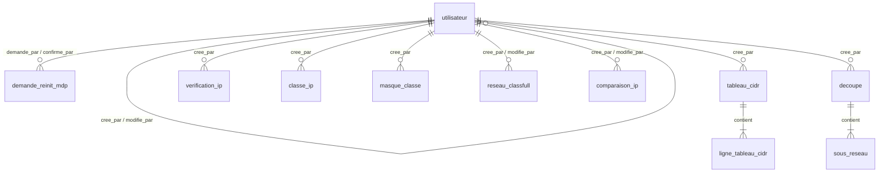

# HELHA.net — Phase 2 : dossier de remise

Projet repris : *Bruno Alexis & Chen Kevin* (phase 1, 2BIA2).
Remise : 11 novembre 2026.

---

## 1. Évaluation de la facilité de transition : **6 / 10**

| Critère | Note | Justification |
|---|---|---|
| Commentaires utiles | 1,5 / 2,5 | Le code est découpé en sections bien visibles (`MOT DE PASSE`, `OUTILS RÉSEAU`…) et le format de `DB.txt` est expliqué en tête. Par contre, peu de commentaires expliquent les calculs réseau, ce qui serait le plus utile pour reprendre le projet. Le cas des masques /31 et /32 n'est jamais mentionné. |
| Noms des variables et classes | 2 / 2,5 | Les noms sont clairs et en français (`calculer_reseau_classfull`, `verifier_format_ip`). On trouve quelques mélanges français/anglais (`is_ip_privee`, `must_change`) et des noms peu parlants (`logoMenu2`, `lbl_c`, `lbl_m`). |
| Structure du projet | 1,5 / 2,5 | La séparation entre la logique (`application.py`) et l'interface (`interface.py`) est nette. Mais `ip_vers_entier` est écrite deux fois, le calcul du masque de classe est dupliqué, et l'interface tient dans une seule classe de 580 lignes. Le dossier `__pycache__` est livré avec le projet. |
| Package et mode d'emploi | 1 / 2,5 | Il n'y a ni README ni `requirements.txt`, alors que la bibliothèque `bcrypt` est nécessaire. Le fichier à lancer (`interface.py`) n'est indiqué nulle part. `AnalyseReseaux.pdf` est une page d'analyse, pas un mode d'emploi. Surtout, **`DB.txt` contient déjà un compte admin (« kevin ») dont on ne connaît pas le mot de passe** : sans vider ce fichier à la main, il est impossible de se connecter. |

---

## 2. Bugs, fonctionnements inadaptés et corrections

Les points B1 à B6 ont été validés par le client. Les autres ont été trouvés en relisant le code. Tous sont corrigés par de petites modifications, sans toucher à la structure (mêmes fichiers, mêmes fonctions).

| ID | Constat | Correction |
|---|---|---|
| B1 | Comparaison de deux IP : un seul masque pour les deux machines (cas T19 et T20 impossibles à tester). | Un masque par machine. Chaque machine applique **son** masque aux deux adresses, et on affiche les deux points de vue ainsi que le réseau de classe. |
| B2 | `+1.2.3.4` et `1. 2.3.4` étaient acceptées comme valides. | On n'accepte que des chiffres, au maximum 3 par octet, avec des valeurs de 0 à 255. |
| B3 | Masque /31 : premier hôte après le dernier, plage inversée. | /31 et /32 affichent « Aucune » et 0 hôte. |
| B4 | Masque /32 : même problème de plage inversée. | Même correction que B3. |
| B5 | `127.0.0.1` et `225.1.4.3` étaient affichées comme « Adresse Publique ». | Trois types : Privée, Publique, Usage particulier. Le multicast et la classe E sont maintenant reconnus comme usage particulier. |
| B6 | `192.168.1.0` affichait « Réservée : Non », ce qui est ambigu. | Nouvelle ligne « Avec le masque de classe : Adresse réseau / broadcast / hôte ». |
| B7 | Réseau classful : `127.x.x.x` était classée « D/E ». | La classe vient de la même fonction que l'analyse IP, donc 127 est bien en classe A. |
| B8 | `0.x.x.x` était classée en classe E. | Classée en classe A (réseau courant, usage particulier). |
| B9 | Réseau classful : un masque plus court que le masque de classe, ou une IP de classe D/E, donnait des résultats faux. | Message d'erreur clair. |
| B10 | Un admin qui se retirait lui-même le rôle admin gardait le menu admin jusqu'à sa déconnexion. | Le compte est relu en base avant chaque action : un changement de rôle, une désactivation ou un changement de mot de passe imposé s'appliquent tout de suite. |
| B11 | La fonction `reinitialiser_mdp` existait mais aucun bouton ne l'appelait. | Bouton « Réinitialiser MDP » dans la gestion des utilisateurs. |
| B12 | Le mot de passe de l'admin initial n'avait aucune règle (1 caractère suffisait). Les autres mots de passe : 6 caractères. | Règle commune : 8 caractères minimum, sans espace, avec majuscule, minuscule, chiffre et caractère spécial. |
| B13 | Un `;` dans un nom d'utilisateur corrompait `DB.txt`, et une coupure pendant l'écriture pouvait vider le fichier. | Disparaît avec SQLite (requêtes paramétrées, transactions). |
| B14 | Un nom tapé avec des espaces au début ou à la fin faisait échouer la connexion. | Les espaces autour sont supprimés. |

**Risque restant, accepté et documenté** : si `helhanet.db` est supprimé, l'application repasse en mode « premier lancement » et propose de créer un nouvel admin. Pour s'en protéger, il faut sauvegarder le fichier et limiter les droits Windows sur le dossier.

---

## 3. Propositions ergonomiques (acceptées et implémentées)

- **E1 — Affichage adaptable** : la fenêtre s'ouvre en plein écran et peut être redimensionnée. Tous les tableaux ont une barre de défilement.
- **E2 — Saisie guidée** : un exemple est affiché à côté de chaque champ. Les messages d'erreur sont précis (« Masque invalide (ex. 255.255.255.0 ou /24) »). La touche Entrée valide depuis n'importe quel champ. Les masques s'écrivent au choix `255.255.255.0`, `/24` ou `24`.
- **E3 — Navigation et résultats lisibles** : la rubrique ouverte reste en surbrillance dans le menu. La comparaison s'affiche en deux colonnes, « Machine 1 » et « Machine 2 ». Le pied du menu affiche le nom et le numéro d'employé de la personne connectée.

---

## 4. Nouvelle fonctionnalité : découpe en sous-réseaux

Menu **Découpe en sous-réseaux**. On saisit un réseau, un masque (s'il est vide, on prend le masque de classe) et le nombre de sous-réseaux voulu N.

1. On emprunte *n* bits à la partie hôte, avec le plus petit *n* tel que 2ⁿ ≥ N.
2. Le nouveau masque vaut /(masque + n). On refuse si on dépasse /30, car il resterait moins de 2 hôtes par sous-réseau.
3. Pour chacun des N sous-réseaux, on affiche l'adresse réseau, le premier hôte, le dernier hôte et le broadcast.

Tous les calculs se font à la main (opérations sur les bits), **sans bibliothèque IP**, comme l'exige l'énoncé. La découpe et ses sous-réseaux sont enregistrés en base (tables `decoupe` et `sous_reseau`).

---

## 5. Traçabilité par numéro d'employé

**Proposition** :
- Chaque compte reçoit un numéro d'employé unique, qui sert de clé primaire à la table `utilisateur`.
- Toute ligne ajoutée dans la base porte `cree_par`, le numéro d'employé de la personne connectée, ainsi que la date.
- Toute modification d'un compte (rôle, activation, mot de passe) porte `modifie_par` et `modifie_le`.
- Pour F5 et F6, on garde aussi le **dernier employé ayant modifié l'enregistrement**. Ces enregistrements peuvent être rechargés depuis l'historique affiché sous le formulaire, puis modifiés.
- Ces colonnes sont des clés étrangères vers `utilisateur(numero_employe)`, donc un numéro inexistant est refusé par la base.

---

## 6. Bouton de sécurité (vol de la base)

Il se trouve dans **Utilisateurs**, bouton rouge « Sécurité : forcer le changement de TOUS les mots de passe ».

- **1er admin** : il clique et la demande est enregistrée dans la table `demande_reinit_mdp`.
- **2e admin, obligatoirement différent, dans les 15 minutes** : il confirme. Tous les comptes passent alors en `must_change = 1`.
- **Différence avec un blocage** : `actif` ne change pas. L'utilisateur peut toujours se connecter, mais il arrive uniquement sur l'écran « Nouveau mot de passe » et n'a accès à rien d'autre tant qu'il n'a pas changé. Un compte déjà désactivé reste désactivé.
- Le nouveau mot de passe doit être **différent de l'ancien**, sinon l'action ne servirait à rien.
- La base vérifie elle-même que le confirmateur n'est pas le demandeur (`CHECK (confirme_par <> demande_par)`). L'application exige aussi au moins 2 admins actifs.

**Limite** : quelqu'un qui aurait volé la base et cassé un hash pourrait se connecter avant le vrai utilisateur et choisir le nouveau mot de passe à sa place. Si le client le souhaite, on peut renforcer le bouton : il remplacerait aussi tous les mots de passe par des mots de passe temporaires, que les admins transmettraient eux-mêmes aux utilisateurs.

---

## 7. Schéma relationnel de la base (SQLite 3, fichier `helhanet.db`)



Notation : PK = clé primaire, FK = clé étrangère, toutes vers `utilisateur(numero_employe)` sauf indication contraire.

- **utilisateur** (<u>numero_employe</u>, nom UNIQUE, hash, role, must_change, actif, cree_par FK, cree_le, modifie_par FK, modifie_le)
- **demande_reinit_mdp** (<u>id</u>, demande_par FK, demande_le, confirme_par FK, confirme_le)
- **tableau_cidr** — F1 (<u>id</u>, cree_par FK, cree_le)
- **ligne_tableau_cidr** — F1, résultat stocké (<u>id_tableau</u> FK → tableau_cidr, <u>prefixe</u>, masque_binaire, masque_decimal)
- **verification_ip** — F2 (<u>id</u>, ip_saisie, cree_par FK, cree_le)
- **classe_ip** — F3 (<u>id</u>, ip, cree_par FK, cree_le)
- **masque_classe** — F4 (<u>id</u>, ip, cree_par FK, cree_le)
- **reseau_classfull** — F5 (<u>id</u>, ip, masque, cree_par FK, cree_le, modifie_par FK, modifie_le)
- **comparaison_ip** — F6 (<u>id</u>, ip1, masque1, ip2, masque2, cree_par FK, cree_le, modifie_par FK, modifie_le)
- **decoupe** (<u>id</u>, ip, masque, nb_sr_demandes, nouveau_masque, cree_par FK, cree_le)
- **sous_reseau** (<u>id_decoupe</u> FK → decoupe, <u>numero</u>, adresse_reseau, premiere_hote, derniere_hote, broadcast)

Conformément aux consignes : F1 stocke son résultat ; F2 à F6 ne stockent que les saisies, car les résultats se recalculent ; seuls F5 et F6 ont un « dernier modificateur ».

---

## 8. Mode d'emploi

```bash
pip install -r requirements.txt
python interface.py
```

1. **Premier lancement** : créer le compte administrateur (nom, numéro d'employé, mot de passe fort).
2. **Créer les comptes** : menu **Utilisateurs**, puis **+ Créer**. Un mot de passe temporaire s'affiche une seule fois ; l'utilisateur le changera à sa première connexion.
3. **Utiliser les outils** : Tableau CIDR (F1), Analyse IP (F2 à F4), Réseau / Sous-réseau (F5), Même réseau ? (F6), Découpe en sous-réseaux.
4. **Lancer les tests automatiques** (20 tests : cas T01 à T20 de la fiche, bugs, découpe, base) avec la commande ci-dessous.

```bash
python -m unittest test_application -v
```
